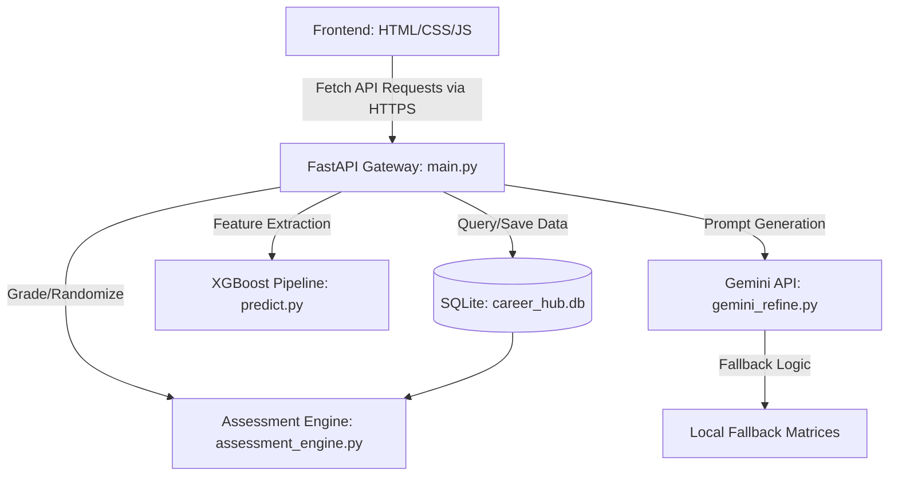
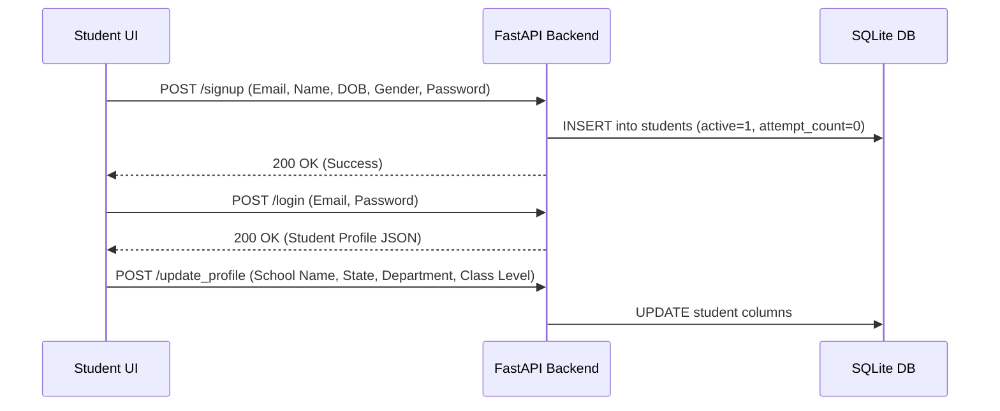
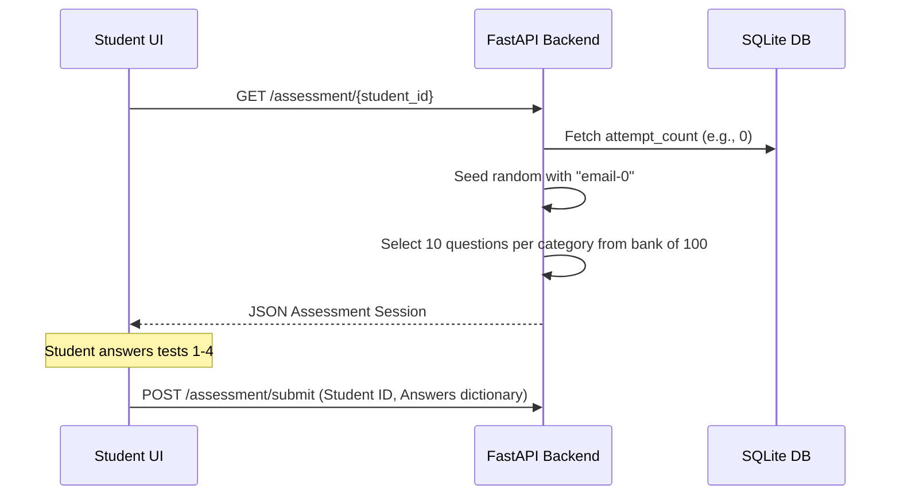
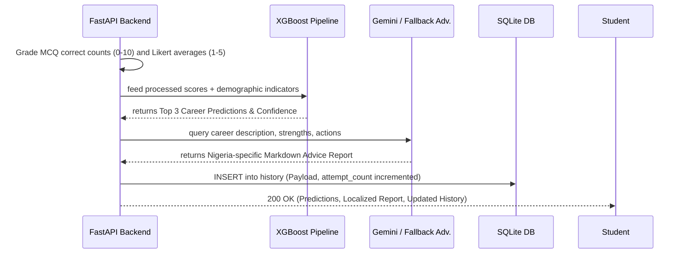

# Smart Career Predictor

## Architecture, Workflow, and Deployment Guide

This repository contains the complete system design, architecture, deployment details, and workflows for the **Smart Career Predictor App**, an AI-powered guidance platform for Nigerian secondary school students.

---

## 1. System Architecture (For Academic/Paper Reference)

The application employs a decoupled architecture separating the presentation layer (frontend) from the data processing and machine learning layers (backend). This enables high scalability and flexible deployment strategies.



### Core Components
1. **Frontend Presentation Layer (`frontend/`)**: A responsive, PWA-ready Single Page Application (SPA) built with pure HTML5, CSS3, and JavaScript. It communicates asynchronously with the backend via `fetch` API, enabling deployment on static hosting platforms like Vercel.
2. **API Gateway Layer (`backend/fastapi_integration/main.py`)**: Implements RESTful architecture using FastAPI. It manages CORS headers (allowing cross-origin requests from the decoupled frontend), handles route routing, and defines Pydantic schemas for data validation.
3. **Core Domain Logic (`assessment_engine.py`)**: Manages the psychometric testing loops, state validation, scoring mechanics, and SQLite database transactions (e.g., storing student profiles, logging assessment scores).
4. **Inference Layer (`predict.py`)**: Utilizes a serialized `scikit-learn` pipeline and an `XGBoost` classifier trained on real survey data (N=403). The model takes **subject grade profiles and student demographic/academic features** as inputs and outputs primary, secondary, and tertiary career probability vectors across 10 defined classes. Assessment test scores (Aptitude, Cognitive, Psychometric, Personality) are graded separately and forwarded to the Gemini advisory layer, not the ML model.
5. **Advisory Engine (`gemini_refine.py`)**: Interfaces with the Google Gemini LLM API to interpret raw ML probabilities into a professional, human-readable mentor report. It includes graceful fallback mechanisms using local matrices to ensure system reliability even when API quotas are exceeded.

---

## 2. System Workflow

The user journey is automated through a synchronized state machine between frontend and backend:

### Step 1: Authentication & Profiling


### Step 2: Assessment Hub & Dynamic Grading


### Step 3: Inference & Report Compilation


---

## 3. SQLite Database Schema

The SQLite schema is designed to allow simple, clean scaling to Firebase or PostgreSQL:

### `students` Table
Stores student accounts, demographics, current class standing, and cumulative credentials:
*   `email` (TEXT PRIMARY KEY): Unique identifier.
*   `name` (TEXT): Full name.
*   `password_hash` (TEXT): Secure hash of the student's password.
*   `phone` (TEXT): Contact number.
*   `dob` (TEXT): Date of Birth.
*   `gender` (TEXT): Gender label.
*   `school_name` (TEXT NULL): Name of secondary school.
*   `school_type` (TEXT NULL): Public/Private indicator.
*   `state` (TEXT NULL): Nigerian state.
*   `class_level` (TEXT NULL): Current grade (`SSS 1`, `SSS 2`, `SSS 3`).
*   `department` (TEXT NULL): Academic stream (`Science`, `Arts`, `Commercial`).
*   `language` (TEXT NULL): Preferred interface language.
*   `uploaded_results` (TEXT NULL): JSON array of completed educational levels (e.g., `["SSS 1"]`).
*   `attempt_count` (INTEGER DEFAULT 0): Assessment session count.

### `history` Table
Stores chronological records of prediction payloads and reports:
*   `id` (INTEGER PRIMARY KEY AUTOINCREMENT): Row identifier.
*   `student_id` (TEXT): References `students(email)`.
*   `attempt_number` (INTEGER): Attempt index.
*   `payload` (TEXT): Complete JSON dump of test scores, predictions, and report text.
*   `created_at` (TEXT): UTC timestamp.

---

## 4. Model Evaluation & Performance Metrics

The career path recommendation engine was evaluated using multiple machine learning classification models in `new_model.ipynb`. The models were evaluated on key classification metrics including **Accuracy**, **Precision**, **Recall**, and **F1-Score**, as well as Stratified 5-Fold Cross-Validation.

### Summary of Model Performance

| Model | Train Accuracy | Test Accuracy | Precision (Macro Avg) | Recall (Macro Avg) | F1-Score (Macro Avg) | Stratified 5-Fold CV |
| :--- | :---: | :---: | :---: | :---: | :---: | :---: |
| **Random Forest (Baseline)** | 99.07% | 86.59% | 0.9 (90%) | 0.87 (87%) | 0.88 (88%) | 85.71% ± 1.90% |
| **XGBoost Classifier (Primary)** | 100.00% | 84.15% | 0.89 (89%) | 0.86 (86%) | 0.86 (86%) | — |
| **Tuned XGBoost Classifier** | 98.46% | 85.37% | 0.9 (90%) | 0.85 (85%) | 0.87 (87%) | 88.17% ± 3.30% |

### Key Metric Details
- **Accuracy**: Achieved **86.59%** test for accuracy Random Forest and **85.37%** test accuracy for XGBoost (Tuned) architectures.
- **Precision**: XGBoost (Tuned) achieved **0.85** in macro average across all target career classes.
- **Recall**: XGBoost (Tuned) achieved **0.85** in macro average across all target career classes.
- **F1-Score**: Macro average of **0.86** (86%) for all career classifications.
- **Cross-Validation**: 5-Fold Stratified Cross-Validation confirmed robust generalization with **85.71% ± 1.90%** for Random Forest and **88.17% ± 3.30%** for Tuned XGBoost.

### Top Predictive Feature Importances (XGBoost Production Model)

| Rank | Feature Name | Importance Weight |
| :---: | :--- | :---: |
| 1 | `jamb_score` | 0.081886 (8.18%) |
| 2 | `french` | 0.059570 (5.95%) |
| 3 | `government` | 0.059464 (5.94%) |
| 4 | `intended_career_path` | 0.051344 (5.13%) |
| 5 | `career_influence` | 0.049751 (4.97%) |
| 6 | `data_processing` | 0.048157 (4.81%) |
| 7 | `technical_drawing` | 0.047208 (4.72%) |
| 8 | `financial_accounting` | 0.044131 (4.41%) |
| 9 | `christian_religious_studies_islamic_studies` | 0.039958 (3.99%) |
| 10 | `waec_year` | 0.038838 (3.88%) |

### How Test Scores Are Used (Architecture Note)

Since the new dataset does not include aptitude/cognitive/psychometric/personality test scores as training features, these scores flow through the system as follows:

```
Student completes frontend assessment tests
          |
          v
Backend grades answers → aptitude_score_10, cognitive_score_10,
                          psychometric_avg_5, sentiment_avg_5
          |
          v
XGBoost predicts career from subject grades + demographics
          |
          v
Gemini LLM receives: XGBoost predictions + test scores
          |
          v
Gemini generates personalised mentor advice weighting both signals
```

This design keeps the ML model grounded in objective academic evidence while allowing the advisory layer to factor in psychometric and aptitude signals that were not present in the training data.

---

## 5. Verification Results

A suite of unit and integration tests was written and executed inside the project's virtual environment:

### Command Run:
```bash
python -m pytest backend/ml_models/tests/test_backend.py -v --tb=short
```

### Results Summary:
*   **Total Tests**: 11
*   **Status**: `11 PASSED, 0 FAILED`
*   **Duration**: 12.96 seconds
*   **Covered Sections**:
    1.  `test_prediction_returns_structure`: Verifies the XGBoost classifier outputs a predicted career, confidence score, and top 3 path listings from subject-grade and demographic features.
    2.  `test_department_alignment_blocks_cross_department_primary`: Verifies the department-to-career mapping prevents cross-department primary recommendations, such as returning `Entrepreneurship & Management` for a Science student.
    3.  `test_mentor_heading_is_forced_to_primary_career`: Ensures the visible `Career Pathway` heading in mentor advice is rewritten to match the primary recommendation if generated advice drifts.
    4.  `test_assessment_session_contains_questions`: Confirms dynamic random question allocation fetches exactly 10 questions per category from the 300-question bank.
    5.  `test_assessment_sessions_shuffle_questions_and_mcq_options`: Verifies each assessment session can receive a different question order and shuffled aptitude/cognitive options.
    6.  `test_assessment_questions_are_department_tailored`: Confirms department-specific sessions only include questions for the student's department plus approved general fallback questions.
    7.  `test_grading_logic`: Validates mathematical grading bounds (Aptitude/Cognitive scored 0–10, Psychometric/Personality scaled 1–5). Correct answers verified against live question bank IDs.
    8.  `test_signup_login_flow`: Tests secure endpoints, credential validation, and duplicate signup errors.
    9.  `test_profile_update_and_submit`: Tests end-to-end integration mapping frontend JSON profiles directly into SQLite writes and grading predictions.
    10. `test_science_submission_prediction_matches_mentor_advice`: Runs a Science-student submission and verifies the primary recommendation, top recommendation card, and mentor advice all resolve to `Medicine & Health Sciences`.
    11. `test_excel_upload_parsing`: Validates Excel result upload parsing and score-to-grade conversion for downstream model features.

---

## 6. Identified Lapses and Recommended Improvements

| Area | Lapsed Behavior | Proposed Improvement |
| :--- | :--- | :--- |
| **API Keys** | Google Gemini key credentials are flagged as leaked/blocked. | Add an active API-key check on startup. Log warnings to let site admins know when falling back to offline advice. |
| **Database Coupling** | Direct SQL execution inside `assessment_engine.py`. | Abstract database operations using a Repository Pattern. This makes it trivial to swap SQLite for Firebase Firestore or PostgreSQL. |
| **Error Handlers** | Frontend fetch calls log to console upon network failure. | Implement visually clean modal cards or retry buttons on the UI to gracefully handle temporary network dropouts. |
| **Test Platforms** | Automation browser subagents require Linux containers. | Shift to platform-agnostic headless tests (e.g. Playwright with bundled Chromium binaries) for cross-platform validation. |

## 7. Deployment Workflow

Because of the decoupled nature of the application, we deploy the **Frontend** and **Backend** separately.

### A. Frontend Deployment (Vercel)

The frontend is a completely static set of files that makes network requests to the backend. It has been configured to dynamically resolve the backend URL based on its environment (localhost vs production).

**Steps to Deploy to Vercel:**
1. Commit all your code and push it to a new public repository on GitHub.
   ```bash
   git init
   git add .
   git commit -m "Initial commit"
   git branch -M main
   git remote add origin https://github.com/yourusername/your-repo-name.git
   git push -u origin main
   ```
2. Log in to [Vercel](https://vercel.com) and click **Add New** > **Project**.
3. Import your GitHub repository.
4. Set the **Framework Preset** to `Other`.
5. Set the **Root Directory** to `frontend/` (or leave as root if `index.html` is in the root directory).
6. Click **Deploy**. In a few seconds, your frontend will be live on a Vercel-provisioned domain.

### B. Backend Deployment (Docker & Render)

The backend runs Python, FastAPI, and machine learning pipelines, requiring a dedicated server environment. We use **Docker** to containerize this environment, guaranteeing it behaves identically to your localhost.

**Docker Architecture:**
- `Dockerfile`: Defines a lightweight `python:3.10-slim-bullseye` image, installs the system compilers required for XGBoost, installs dependencies from `requirements.txt`, and boots the `uvicorn` server.
- `docker-compose.yml`: Facilitates local testing of the containerized setup.

**Steps to Deploy to Render:**
1. Create a free account on [Render.com](https://render.com).
2. Click **New +** and select **Web Service**.
3. Connect your GitHub repository.
4. Render will automatically detect the `Dockerfile` in your repository.
5. Ensure the **Environment** is set to `Docker`.
6. Add your Environment Variables under the **Advanced** tab:
   - `GOOGLE_API_KEY` = `your_gemini_api_key_here`
7. Click **Create Web Service**. 
8. Render will build the Docker container and provide you with a live URL (e.g., `https://smart-career-backend.onrender.com`).

### C. Linking the Frontend and Backend
Once your backend is live on Render:
1. Open `frontend/smart-career-predictor.html`.
2. Locate the `API_BASE_URL` variable at the top of the script section.
3. Update the production fallback URL to your new Render URL:
   ```javascript
   const API_BASE_URL = window.location.hostname === 'localhost' || window.location.hostname === '127.0.0.1' ? '' : 'https://smart-career-backend.onrender.com';
   ```
4. Commit and push this change to GitHub. Vercel will automatically trigger a new deployment, and your live frontend will now communicate securely with your live Docker backend!

---

## 8. Functionality Assurance (Localhost vs Production)

By utilizing `CORSMiddleware` in the FastAPI backend (`allow_origins=["*"]`) and the dynamic `API_BASE_URL` in the frontend, **the application will function exactly as it did on localhost**. 
- On `localhost`, the frontend will continue to send requests to `` (relative paths), seamlessly hitting your local Python server.
- On `Vercel`, it will append the Render URL to all requests, successfully bypassing cross-origin restrictions and delivering identical performance and behavior.
